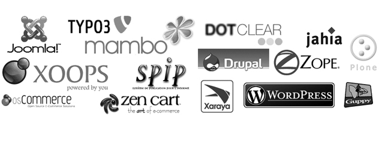

# Sistema de Gestión de Contenidos

## **¿Qué es un CMS?**

Un **CMS** (*Content Management System*) es un sistema de gestión de contenidos que permite crear, editar y administrar páginas web sin programarlas desde cero. Separa el **contenido** (textos, imágenes, vídeos) del **diseño** (plantillas y temas), de modo que se puede modificar uno sin afectar al otro.

## **Funcionamiento**

Un CMS funciona a través de un servidor web que recibe peticiones HTTP de los usuarios:

1. El usuario solicita una página desde el navegador.
2. El servidor ejecuta el código del CMS, escrito en un lenguaje del lado del servidor como PHP, Python o Node.js.
3. El CMS consulta la base de datos relacional (por ejemplo, MySQL o MariaDB), donde se almacenan los contenidos, usuarios y configuración.
4. Con esos datos y la plantilla elegida, construye el HTML y lo envía al navegador.

Por tanto, el CMS **no guarda las páginas HTML ya hechas**: solo almacena los datos y genera cada página en el momento de la petición.

## **Tipos**

**Según su licencia:**

- **Código abierto (Open Source):** gratuitos y modificables. Ejemplos: WordPress, Joomla y Drupal.
- **De pago (propietarios o SaaS):** se contratan como servicio y el proveedor se encarga del alojamiento y el mantenimiento. Ejemplos: Shopify y Wix.

**Según su arquitectura:**

- **Monolíticos:** el panel de administración (*back-end*) y la web visible (*front-end*) forman un único sistema. Ejemplo: WordPress tradicional.
- **Desacoplados (*headless*):** el CMS solo gestiona y entrega el contenido mediante una API, y el *front-end* se desarrolla de forma independiente. Ejemplo: Strapi.

## **Ejemplos**

| CMS | Característica principal | Tipo |
|---|---|---|
| WordPress | Flexibilidad (miles de plugins y temas) | Open Source |
| Joomla | Comunidad | Open Source |
| Drupal | Seguridad | Open Source |
| Shopify | Ventas (comercio electrónico) | De pago |
| Wix | Simplicidad | De pago |
| Squarespace | Estética | De pago |
| Webflow | Diseño | De pago |
| Strapi | Libertad (personalización total) | Open Source, desacoplado |
| Contentful | Escalabilidad | De pago, desacoplado |
| Storyblok | Edición visual | De pago, desacoplado |

## **Comparativa: CMS dinámico y generador estático**

| Aspecto | CMS dinámico | Generador estático |
|---|---|---|
| **Forma de crear contenidos** | Mediante un panel visual | Mediante código y archivos de texto |
| **Base de datos** | Suele utilizar una base de datos | Normalmente no requiere una base de datos |
| **Generación del HTML** | Se genera cuando el usuario accede a la página | Se crea antes de la publicación de la web |
| **Servidor necesario** | Depende de un servidor que procese el contenido | Normalmente no necesita procesamiento en el servidor |
| **Panel de administración** | Está incluido | No suele estar incluido |
| **Conocimientos técnicos** | No requiere muchos conocimientos técnicos | Requiere conocimientos previos |
| **Seguridad** | Tiene más puntos vulnerables a ataques | Tiene menos puntos de ataque al no depender de una base de datos |
| **Rendimiento** | Puede ser más lento al procesar la información | Es más rápido porque las páginas ya están creadas |
| **Actualización del contenido** | Se realiza desde el panel de administración | Se debe modificar el contenido y volver a publicar la web |
| **Publicación** | Se utiliza el propio CMS | Se generan los archivos y luego se suben al servidor |
| **Ejemplos** | WordPress, Drupal y PrestaShop | Hugo, Jekyll y Astro |

## **Vídeo explicativo**

[Ver vídeo en YouTube](https://youtu.be/-xoh7kAJPtI?si=ahR1OzGkBvIiPiCv)

## **Contenido sobre sitios estáticos**

[Siguiente documento: Generadores de sitios estáticos](ssg.md)

